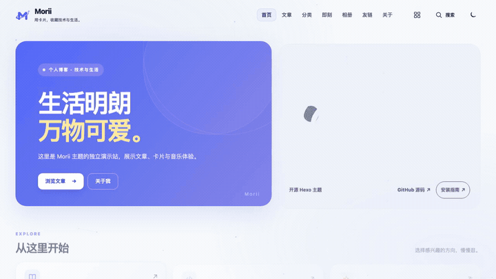

# Morii Theme

[](https://www.npmjs.com/package/hexo-theme-morii)
[](LICENSE)

**English** · [简体中文](README.zh-CN.md)

Morii is a card-based Hexo theme for technical writing and personal blogs. It supports English, Simplified Chinese, and Traditional Chinese.

[Documentation (Chinese)](https://morii-docs.pages.dev/) · [Live demo](https://xichenx.github.io/hexo-theme-morii/) · [Releases](https://github.com/xichenx/hexo-theme-morii/releases) · [Issues](https://github.com/xichenx/hexo-theme-morii/issues)

[](https://github.com/xichenx/hexo-theme-morii/blob/main/docs/media/morii-demo.mp4)

[Watch the 44-second v1.1.0 demo](https://github.com/xichenx/hexo-theme-morii/blob/main/docs/media/morii-demo.mp4)

## Features

- Responsive card layouts, light and dark modes, and configurable homepage sections.
- Local full-text search with highlighted excerpts, plus categories, tags, and series.
- Reading progress, focus mode, a reading list, and an expanded code viewer.
- Albums, short updates, friend links, a music room with synchronized lyrics, and a cinema page.

## Quick start

Use Hexo 8 or later and Node.js 20.19 or later. Run this command in your blog root.

```bash
npm install hexo-theme-morii hexo-renderer-pug
```

Set `theme: morii` and `language: en` in the blog’s `_config.yml`, then preview it with `npx hexo server`.

## Documentation

The Chinese documentation site covers [installation](https://morii-docs.pages.dev/guide/), [configuration](https://morii-docs.pages.dev/config/), [examples](https://morii-docs.pages.dev/examples/), [deployment](https://morii-docs.pages.dev/guide/publishing), and [upgrading to v1.1.0](https://morii-docs.pages.dev/guide/upgrade-1-1).

[Changelog](CHANGELOG.md) · [MIT license](LICENSE) · Theme by **Morainet**
