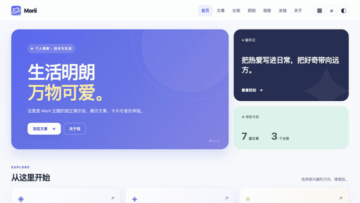

# Morii Theme

[](https://www.npmjs.com/package/hexo-theme-morii)
[](LICENSE)
[](package.json)
[](package.json)
[](languages/)
[](https://github.com/xichenx/hexo-theme-morii/stargazers)

**English** · [简体中文](README.zh-CN.md)

**Morii by Morainet — A card-based Hexo theme for stories, code, and everyday life.**

Responsive layouts, light and dark modes, local full-text search, reading preferences, and dedicated music and photo pages. Built with Pug and native CSS / JavaScript, with English, Simplified Chinese, and Traditional Chinese interfaces.

[Quick start](#quick-start) · [Features](#features) · [Configuration](#configuration) · [Documentation (Chinese)](https://morii-docs.pages.dev/) · [Watch the demo](https://github.com/xichenx/hexo-theme-morii/blob/main/docs/media/morii-demo.mp4) · [Report an issue](https://github.com/xichenx/hexo-theme-morii/issues)

**Topics:** `hexo` · `hexo-theme` · `blog` · `responsive` · `dark-mode` · `multilingual` · `pug` · `javascript`

## Quick start

Requires an existing Hexo 8+ blog and Node.js 20.19+. Run this command from your **blog root**:

```bash
npm install hexo-theme-morii@latest hexo-renderer-pug
```

Update the existing entries in your blog's **`_config.yml`** to use the English interface:

```yaml
title: My Morii Blog
subtitle: Notes on code and everyday life
description: A place for projects, reading notes, and small discoveries.
author: Your Name
language: en
theme: morii
```

Create **`_config.morii.yml`** in the same blog root, or merge these entries into your existing theme configuration:

```yaml
# Inherit your blog title, subtitle, and description.
brand: ''
tagline: ''
intro: ''

# Both images are included with the theme.
logo: /icons/brand/morii-orbit-nav.png
favicon: /icons/brand/morii-orbit-favicon.png

accent: '#5568f6'
accent_dark: '#8c9aff'

menu:
  - name: Home
    path: /
  - name: Posts
    path: /archives/
```

Generate and preview your blog:

```bash
npx hexo clean
npx hexo generate
npx hexo server
```

The theme interface follows `language: en`; post content and custom text keep their original language. You can also use `zh-CN` or `zh-TW`, or set `lang: en` in a page's Front Matter. The theme falls back to Simplified Chinese when the language is unsupported. See the [configuration guide](https://morii-docs.pages.dev/config/) for optional features.

## Demo

[](https://github.com/xichenx/hexo-theme-morii/blob/main/docs/media/morii-demo.mp4)

**[Watch the full demo](https://github.com/xichenx/hexo-theme-morii/blob/main/docs/media/morii-demo.mp4)** · [Download MP4](https://github.com/xichenx/hexo-theme-morii/raw/refs/heads/main/docs/media/morii-demo.mp4)

About 44 seconds, 1280 × 720, without music. Recorded from the standalone demo site using `v0.1.0-alpha.2`; the preview GIF is an excerpt. The full video includes Chinese subtitles and chapters.

| Time | Preview |
| --- | --- |
| 00:00 | Homepage, branding, and content cards |
| 00:07 | Article reading and preferences |
| 00:14 | Categories and timeline archives |
| 00:21 | Image viewer and music player |
| 00:28 | Search and dark mode |
| 00:36 | Mobile homepage and categories |

## Features

- Responsive home, article, archive, category, tag, and 404 pages, with configurable card, list, directory, and timeline layouts.
- English, Simplified Chinese, and Traditional Chinese interfaces, selected by the blog's `language` or a page's `lang`.
- Light and dark modes, optional aurora backgrounds, particles, glass effects, hover lighting, and motion that respects reduced motion preferences.
- Featured posts, series navigation, category browsing, recent moments, random post discovery, and a GitHub contribution calendar.
- Local full-text search with highlighted excerpts, category filters, on-demand loading, index shards, and a Web Worker for larger sites.
- Reading progress, an adaptive table of contents, font sizes, focus mode, saved reading positions, related posts, and previous / next navigation.
- Code copying, collapsible code blocks, configurable code styles and palettes, and optional Mermaid and KaTeX rendering.
- A local reading list with filtering and JSON import / export, article sharing, and print / PDF previews.
- About, friend links, moments, albums, music, cinema, a friends feed, and a small air conditioner web toy.
- An image viewer with keyboard navigation, 1–8× zoom, dragging, pinch gestures, photo details, and retry controls.
- A full music player with synchronized lyrics, playlists, playback modes, and continuous audio across navigation within the same tab.
- Optional weather and clock cards, social links and QR codes, announcements, popular tags, site statistics, and article age notices.
- Canonical URLs, Open Graph metadata, article timestamps, Waline / Twikoo integration, and compatibility with existing `tabs`, `folding`, `link`, `label`, and `p` tags.

Series use `series` / `series_order` in post Front Matter. Local covers can produce responsive WebP images through the optional `sharp` dependency; remote images support explicit candidates. Article headers support cover color extraction, and diagrams redraw when the color mode changes. See [content configuration](site/config/content.md).

CSS and JavaScript assets use content fingerprints. The theme also provides `hexo morii:check`, optional local loading diagnostics, `note` and `codefile` tags, and per-post diagram / math rendering. Rendering libraries are not loaded by default; failed rendering preserves the source. See [additional features](site/config/iteration.md).

## Installation options

To install from Git instead of npm, run these commands in your blog root:

```bash
git clone https://github.com/xichenx/hexo-theme-morii.git themes/morii
npm install hexo-renderer-pug
```

Set `theme: morii` in your blog's `_config.yml`. Morii uses Pug and native CSS / JavaScript without a separate frontend bundling step. The development environment uses Hexo 8.1.2.

With npm, the theme lives in `node_modules/hexo-theme-morii`; with Git, it lives in `themes/morii`. Put personal overrides in the blog root's `_config.morii.yml` so theme upgrades preserve your settings. Site identity inherits your blog configuration, and external services are opt-in without the author's accounts prefilled.

You can copy the theme's `_config.yml` to the blog root as `_config.morii.yml`, start from the [minimal configuration](site/public/examples/minimal/_config.morii.yml), or use the English example above. Merge fields into an existing configuration rather than adding duplicate keys.

The optional `npx hexo morii:init` command interactively creates pages, menus, and empty data files. Use `--yes` for the default pages, or `--pages about,categories,tags,music --dry-run` to preview the plan. Existing files are preserved, and conflicting configuration is saved as a separate suggestion. See [initialization](site/guide/initialization.md), [updating](site/guide/updating.md), and the [getting started guide (Chinese)](https://morii-docs.pages.dev/guide/getting-started).

## Interface languages

Set the language in the **blog root's `_config.yml`**, not in the theme configuration:

```yaml
language: en # en / zh-CN / zh-TW
```

Run `npx hexo clean` and `npx hexo generate` after changing it. Unsupported languages fall back to `zh-CN`. If `language` is an array, the theme uses its first item; it does not generate separate language versions of the site.

Navigation, buttons, search, the music player, the reading list, and the image viewer follow the selected language. Post titles, content, categories, and personal descriptions are not automatically translated. Set `lang: en` or `lang: zh-TW` in a page's Front Matter to override the site language. Translations live in `languages/`; English and Traditional Chinese browser bundles load and cache as needed.

Default menu labels are translated automatically. Custom names can be plain strings or language maps in `menu` / `explore`:

```yaml
menu:
  - name:
      en: My notes
      zh-CN: 我的笔记
      zh-TW: 我的筆記
    path: /archives/
```

Language maps prefer the current language, then Simplified Chinese, English, and Traditional Chinese. Third-party comment widgets and embedded players control their own interface language.

## Configuration

Use the blog root's `_config.morii.yml` to override the theme settings. The complete defaults live in the theme's `_config.yml`.

### Branding and icons

`logo` controls the navigation mark; `favicon` controls the browser tab icon. Both accept site paths or full image URLs:

```yaml
logo: /icons/brand/morii-orbit-nav.png
favicon: /icons/brand/morii-orbit-favicon.png
```

Both Orbit images ship with the theme and are sized for their respective uses. Put custom images in your blog's `source/` directory and omit `source` from the configured path. An empty `logo` or a failed logo image uses the fallback star mark.

Homepage `featured[].icon` entries accept built-in line icon names such as `book`, `code`, `sparkles`, and `sun`. Quick navigation selects matching icons from page paths. Custom characters are also supported; unknown names display as text.

This repository contains the Morii theme. Blog posts, the original AnZhiYu theme, and site-specific `source/_data/` files are managed separately. When migrating an existing blog, review demo content in moments and friend links, and disable old theme-specific clock or Live2D plugins as needed.

### Footer uptime and registration

Uptime is disabled by default. To enable it, provide your own launch date in ISO format with a timezone:

```yaml
footer:
  runtime:
    enable: true
    start: '2024-03-15T00:00:00+08:00'
    label: Online for
```

The browser updates days, hours, minutes, and seconds, pausing while the tab is hidden. Without JavaScript, the build-time value is shown. Invalid dates hide the display; `enable: false` disables it. Uptime shares a compact footer row with registration details and wraps on small screens.

`footer.filing` supports optional Chinese ICP and public security registration details. It is disabled by default, and empty entries are hidden. Fill in your own registration numbers and verification URLs; the theme does not verify registration status. A public security entry without a URL appears as plain text.

```yaml
footer:
  filing:
    enable: true
    icp:
      number: 'YOUR_ICP_REGISTRATION_NUMBER'
      url: https://beian.miit.gov.cn/
    police:
      number: ''
      url: ''
```

### Homepage and post browsing

Use `home.selected_posts` to choose featured posts by title, path, or slug, in display order. `home.selected_limit` accepts 1–6 posts. You can also set `featured: true` in a post's Front Matter. Duplicates and encrypted posts are excluded; if nothing is selected, the theme uses recent public posts.

```yaml
home:
  selected_limit: 3
  selected_posts:
    - Getting Started with Hexo
    - My Reading Notes
    - Building a Personal Blog
```

The large introduction and featured cards appear only on the first homepage page. Later pages show the post list and pagination. Category links lead to complete generated category pages. Archives preserve their year / month scope, and pagination supports custom paths and abbreviated page ranges.

Sidebar category and year counts come from site posts; recent updates sort by `updated`. Automatic excerpts skip code blocks, line numbers, and scripts, with a code-note fallback for posts containing only code.

### Clock and weather

`clock.enable` controls clock / weather cards on home, archive, and article sidebars. The feature is disabled by default, without a prefilled city or coordinates. With only `enable: true`, it shows the clock in the site's timezone. Weather requires both latitude and longitude; `clock.timezone` can override the site's timezone for this card.

Weather uses current data from the [Open-Meteo Forecast API](https://open-meteo.com/en/docs), including conditions, temperature, humidity, wind direction, and update time. It refreshes every 10 minutes and can reuse cached data for up to an hour. Failed requests allow manual retry while the clock and city remain visible. The page uses the configured city without requesting visitor location or looking up visitor IP addresses. Check the provider's terms for commercial use.

The old `electric_clock` plugin remains disabled, and Morii does not read or output its API keys. If a weather service requires a secret, use your own backend proxy.

### Quick navigation

The header grid button or `?` opens the navigation panel. Links come from `menu` and `explore`, with tags and the reading list added automatically. Duplicate paths appear once. Menu items support `icon` and `description`; disabling the reading list also hides its entry. Set `quick_navigation.enable: false` to disable the panel, button, and script.

The panel includes search, reading controls, and music controls. `⌘/Ctrl + K` opens search and `Esc` closes navigation. The `?` shortcut is ignored while typing or when another dialog is open. Closing the panel restores focus; mobile uses two columns.

### Local search

Search loads the generated `morii-search.json` on first use and reuses it on the current page. It searches titles, body text, categories, and tags, with all query terms required and title matches ranked first. Excerpts highlight matching text. Set `search.content: false` to exclude body text while keeping titles, excerpts, categories, and tags. `search.page_size` accepts 5–30 results per batch, with a default of 10.

The panel supports all-content, title-only, and category / tag scopes, plus popular tag shortcuts. Use `↑` / `↓` to move between the query and results, `Enter` to open the first result, and `Esc` to close. Input method composition does not trigger navigation. The results scroll independently of the header and footer.

Larger sites use an inverted index to select body shards and a Web Worker to filter and rank results, with fallbacks for older indexes and the main thread. Failed body-index downloads retain title / excerpt searches and allow retry. Encrypted posts expose only their title, path, and date; unpublished posts are excluded. Queries are processed locally in the browser, and index / post URLs follow the site's `root` for subdirectory deployments.

### Moments and random posts

`home.moments.enable` controls the moments preview; `limit` accepts 1–10 entries, defaulting to 5. It reads nonempty entries from groups marked `home_essay: true` in `source/_data/essay.yml`, respects each group's limit, and sorts newest first. Plain-text previews link to the corresponding moments card; empty data hides the section. Switching is manual, without autoplay.

`home.random.enable` controls random post discovery. It excludes encrypted, unpublished, and duplicate entries. The next-post button changes the preview; the reading link opens the post. Each round avoids repeats, including an immediate repeat across rounds. Without JavaScript, the first moment and latest public post remain visible. Both modules appear only on the first homepage page. Replace inherited demo entries with your own, or set a group's `home_essay` to `false` to hide it from the preview.

### About, albums, and friend links

The profile card and about page share the `social` list. No accounts are prefilled. Profile links open in a new tab; mobile app handling depends on the platform and operating system.

```yaml
social:
  - name: GitHub
    icon: github
    url: https://github.com/your-name
    description: Follow me on GitHub
  - name: WeChat
    icon: wechat
    qrcode: /images/wechat-follow.png
    account: YOUR_ACCOUNT
    description: Scan to follow
```

`url` accepts HTTP / HTTPS profile links; `qrcode` accepts a site path or HTTP / HTTPS image URL. Supply your own QR image. You can provide either or both. Set `enable: false` to hide one entry, or `social: false` to hide all entries. With Hexo 8 configuration merging, `social: []` does not clear inherited lists. Invalid addresses and duplicates are ignored.

Local platform icons include `github`, `csdn`, `bilibili`, `wechat`, `weibo`, `zhihu`, `douyin`, `xiaohongshu`, and `telegram`. See [icon sources](source/icons/social/NOTICE.md). Other platforms use the first two characters of their name. QR dialogs provide loading feedback, an original-image link, and keyboard dismissal.

These pages read `source/_data/about.yml`, `album.yml`, and `link.yml`. About-page post, category, and album counts are calculated from real site content. Personal tags, experience, and interests come from the data files; `about.show_interests` controls interest cards.

Albums match page paths using `path_name`. `album_list[].image` accepts an image URL or an array; empty entries are ignored. Photo details use `content`, `address`, `from`, and `date`. Browse with arrows or keyboard keys and close with `Esc`; failed images offer retry and original-image links.

Friend links use grouped cards with a site contact card in the sidebar, switching to one column on mobile. Filtering combines site names, descriptions, tags, and domains. Existing `siteshot`, `tag`, and `recommend` fields are supported, with gradient or text fallbacks for failed images and matching counts for each group. The contact card uses your site title, URL, description, and theme avatar; its JSON can be copied or selected manually when clipboard access is unavailable.

### Article sharing and printing

The article share dialog copies plain or Markdown links and offers the system share sheet when supported. Sharing includes only the article title and canonical URL, with Markdown escaping. Clipboard failures select the text for manual copying. Close the dialog or press `Esc` to return focus to its trigger. Set `article.share.enable: false` to disable the dialog; the existing copy-link button remains available.

Reading settings and the article footer provide a print / PDF preview. The print stylesheet hides navigation, sidebars, comments, and action buttons, expands folded content and long code, and appends the site, author, and source link. Body images remain; audio, video, embedded pages, and the article cover are excluded.

Returning to reading or pressing `Esc` restores the previous folds and scroll position. Direct browser printing also temporarily expands folded content and restores it afterward. Printing uses currently loaded content; it does not retrieve failed resources or decrypt articles. Pagination and paper settings are controlled by the browser. Set `article.print.enable: false` to disable the theme's print controls and stylesheet.

### Reading list

Readers can save posts from below the article title and open `/reading-list/` from sidebar or footer links. The list keeps up to 100 post paths in the current browser's `morii-reading-list` storage; titles and dates come from the site index. It does not store article bodies or automatically sync across browsers or devices. Clearing site data removes the list.

The list supports resume and remove controls, combined title / category / tag / path filters, retry after index failures, and automatic updates across tabs. Missing posts remain saved until removed manually. Unavailable browser storage produces a visible message. Set `reading_list.enable: false` to disable its controls, links, and generated page; `reading-list/` is a reserved theme route.

Readers can export JSON and import it in another browser. Imports merge and deduplicate paths, handle changed site roots, and report entries beyond the 100-post limit. Supported Morii backups must be at most 256 KB and are read locally without uploading. Backups contain post paths, not body text, reading positions, or account details.

### Reading settings and article layout

Articles use a wide cover with category, tags, publication and update dates, reading time, and author details. Covers prefer `top_img`, then `cover`; `top_img: false` selects a gradient. Body and author sidebar use separate cards. Typography defaults to 17 px, with independent heading, list, table, and quote styles and horizontal scrolling inside long code blocks.

Reading settings offer 15 / 17 / 19 / 21 px body text and a focus mode that hides the sidebar and centers the article. Preferences persist in the current browser; resetting restores 17 px and clears local preferences. Without storage, controls still affect the current page.

Desktop table-of-contents and weather cards stick independently of the author card, with scrolling when the window is short. The table of contents supports H1–H6, highlights the current section, and updates after decryption. Mobile, tablet, and focus layouts provide a floating contents control with reading progress. Without JavaScript, a collapsible table of contents remains before the body.

Set `article.reading_settings: false` to hide controls and disable saved preferences. Without JavaScript, the default layout is used.

Reading positions are saved locally for up to 50 posts and 90 days. Returning readers can resume or clear a saved position; completing an article removes it. Updated posts, links with section anchors, and encrypted posts do not offer outdated positions. Set `article.resume.enable: false` to disable this feature.

### Sidebar cards and article age notices

`sidebar.announcement` accepts `enable`, `title`, and plain-text `content` with line breaks. `sidebar.tags` accepts `enable` and a `limit` of 1–40, defaulting to 12, sorted by post count. `sidebar.stats.enable` shows post counts, public-content word estimates, and the earliest post date. Counts exclude code, encrypted bodies, and unpublished posts.

`article.outdated.enable` displays an age notice after `days` since the last update, defaulting to 365. It falls back to the publication date and stays hidden for invalid dates or encrypted posts. The browser recalculates age to avoid stale static notices. Set `outdated: false` in a post's Front Matter to disable its notice, and maintain the Hexo `updated` field for long-lived articles.

### Related posts and code blocks

`article.related` ranks recommendations by shared tags (3 points each) and categories (1 point each), with newer posts winning ties. It excludes the current post, duplicates, encrypted posts, and unpublished posts. `limit` accepts 1–6, defaulting to 3; no matches hide the section.

`article.navigation` controls previous / next links. Code blocks support `classic`, `mac`, and `minimal` styles with `dark`, `light`, or `auto` palettes. `article.code.collapse` folds long code; `lines` accepts 5–100 preview lines, defaulting to 18. Expand controls work with the keyboard, copying always includes the full code, and decrypted content is processed too. Without JavaScript, code remains fully visible.

```yaml
article:
  navigation: true
  related:
    enable: true
    limit: 3
  code:
    style: classic # classic / mac / minimal
    theme: dark    # dark / light / auto
    collapse: true
    lines: 18
```

### Air conditioner toy

The footer links to `/air-conditioner/`, a web toy with power, 16–30°C temperature, heating / cooling, and swing controls. Temperature, mode, and swing settings are stored locally; revisiting starts with the power off. It simulates controls without connecting to a physical device or playing sound, and works without local storage.

### Friends feed

Set `friends_feed.endpoint` to your own JSON endpoint. Requests use `start` and `end` pagination parameters and accept arrays or `article_data` arrays / keyed objects. Article fields are `title`, `link` (or `url`), `author`, `avatar`, and `created` (or `date` / `updated`). Cross-origin endpoints must allow the blog's origin through CORS.

The endpoint is empty by default. Without an endpoint, or when requests fail, the page falls back to existing friend links.

### Music

The music page provides cover art, synchronized lyrics, a searchable playlist, seek controls, lyric seeking, volume, and sequential, list-loop, single-loop, and shuffle modes. Mobile readers can switch between lyrics and the playlist.

Opening the music page loads its playlist; playback begins only after user interaction. Once playing, navigation within the same tab retains the audio instance. Other pages show a floating music capsule with play / pause, track navigation, expandable current lyrics, and a link back to the player. Same-origin content navigation updates the URL and title and runs each page's initialization and cleanup. External links, downloads, and new tabs keep their normal behavior.

Refreshing or closing the tab reloads the player without autoplay. Before playback begins, ordinary pages do not request the online playlist.

Online playlists use Meting-compatible configuration and are disabled by default. In the blog root's `_config.morii.yml`, supply your own playlist:

```yaml
music:
  playlist_url: https://y.qq.com/n/ryqq/playlist/YOUR_PLAYLIST_ID
  playlist_label: Listen on QQ Music
  volume: 0.7
  meting:
    enable: true
    server: tencent # Use netease for NetEase Cloud Music.
    type: playlist
    id: 'YOUR_PLAYLIST_ID'
    api: 'https://api.injahow.cn/meting/?server=:server&type=:type&id=:id&r=:r'
  tracks: []
```

Replace `api` with your own Meting-compatible service if needed; it must permit cross-origin requests. Responses support `name/artist/cover` or `title/author/pic` fields. Playlists are fetched in the browser, without caching temporary audio URLs at build time. Availability depends on the service and music platform; failures offer retry and a link to the original playlist.

Disable `music.meting.enable` to use configured tracks only, or provide `music.tracks` as an online-playlist fallback:

```yaml
music:
  meting:
    enable: false
  tracks:
    - title: Example track
      artist: Artist name
      url: https://your-domain.example/audio/example.mp3
      cover: https://your-domain.example/images/cover.jpg
```

An official HTTPS `music.embed_url` can display an embedded player. Local tracks support `lrc: /audio/example.lrc` or inline timestamped lyrics with `lyrics: |`. Online playlists use the returned `lrc`. Missing lyrics do not prevent audio playback. Track and cover paths can be site paths such as `/audio/example.mp3`. Without JavaScript, the original playlist link remains available.

### Cinema

When enabled, the theme generates `/cinema/` with movie, series, and anime categories, title search, and episode selection. Put your video files in the blog's `source/videos/` and create `source/_data/cinema.yml`:

```yaml
- title: Weekend short film
  type: movie
  year: '2026'
  description: A short film for the weekend.
  cover: /images/weekend-poster.jpg
  url: /videos/weekend.mp4

- title: My series
  type: series
  year: '2026'
  cover: /images/series-poster.jpg
  episodes:
    - title: Episode 1
      url: /videos/series-01.mp4
    - title: Episode 2
      url: /videos/series-02.webm

- title: Animated short
  type: anime
  episodes:
    - title: Full video
      url: https://video.example.com/anime.mp4
```

Enable the page with `cinema.enable: true` in `_config.morii.yml`. `movie`, `series`, and `anime` select the categories. Use `url` for a single video or `episodes` for multiple videos. The same data can go in `cinema.items`; site data takes priority. URLs accept site paths or HTTPS addresses, including subdirectory deployment prefixes. Playback uses native browser controls; format support depends on the browser and codecs, and external hosts must allow embedding. Empty data shows a setup prompt. If you disable the page, remove its `explore` link too.

### Motion

Card entrances, homepage decoration, hover feedback, button presses, and dialog transitions are enabled by default. Cards animate on their first entry into view, including asynchronously added cards. Article paragraphs do not animate individually, and keyboard focus immediately finishes the focused card's entrance. Content remains visible without JavaScript or animation support.

```yaml
motion:
  enable: true # Set false to disable page motion.
```

The theme respects reduced motion preferences, including changes during a session. Homepage decoration pauses offscreen and in background tabs; printing disables motion. Music covers, the air conditioner, and footer hearts follow their own settings and system preferences.

### GitHub contribution calendar

The first homepage page can show a contribution calendar below featured content:

```yaml
github_calendar:
  enable: true
  user: YOUR_GITHUB_USERNAME
  api: 'https://github-contributions-api.jogruber.de/v4/{user}?y=last'
```

If the theme username is unset, the site-level `githubcalendar.user` can supply it. Morii replaces the old plugin's layout, script, and colors with native rendering; old API settings are not inherited. You can use your own [GitHub Contributions API v4](https://github.com/grubersjoe/github-contributions-api) compatible endpoint with CORS enabled, without putting a GitHub token in the theme. Results cache for an hour, show the data end date, and provide retry / profile links. Values represent the service's contribution counts, not commit counts. Disabling the feature prevents script loading.

### Page layouts

Choose layouts in the blog root's `_config.morii.yml`, then regenerate the site and restart local preview:

```yaml
appearance:
  layouts:
    home: featured
    categories: atlas
    category: list
    archives: timeline
```

| Setting | Choices | Default |
| --- | --- | --- |
| `home` | `featured`: emphasize the first post when the latest-post count is odd; `grid`: two-column cards | `featured` |
| `categories` | `atlas`: two-column topic navigation; `directory`: index and recent posts; `cards`: category cards | `atlas` |
| `category` | `list`: topic navigation and post rows; `cards`: post cards and a sidebar | `list` |
| `archives` | `timeline`: year-based timeline; `grouped`: cards grouped by year | `timeline` |

Each choice is independent. Missing values use defaults; invalid values log a warning and fall back. Only built-in layouts are accepted. Layouts do not change post counts, ordering, routes, pagination scope, or saved reading preferences. Hexo's `index_generator`, `category_generator`, `archive_generator`, and global `per_page` still control pagination.

### Visual effects

Configure effects alongside layouts under the same `appearance` mapping:

```yaml
appearance:
  effects:
    enable: true
    aurora: true
    particles: true
    density: 48
    glass: true
    spotlight: true
    tilt: true
    ripple: true
    theme_transition: true
```

- `aurora`: a slowly moving gradient background.
- `particles`: native Canvas stardust, nearby connections, and pointer avoidance. `density` accepts 12–80; mobile uses at most 18 particles, with drawing capped around 30 fps and a 1.5 pixel ratio.
- `glass`: translucent navigation and display cards, with solid article backgrounds and browser fallbacks. Mobile cards disable background blur.
- `spotlight`: pointer-following card lighting on precise pointing devices and a hover highlight on the homepage action button.
- `tilt`: up to 3° of card tilt on precise pointing devices, reset on pointer leave or scrolling and disabled for touch.
- `ripple`: button feedback for pointer and keyboard activation.
- `theme_transition`: circular light / dark transitions using the [View Transition API](https://developer.mozilla.org/en-US/docs/Web/API/View_Transition_API/Using), with instant switching when unsupported, reduced motion is requested, or data saving is enabled.
- `enable: false`: disable these effects and their CSS / JavaScript. Page entrance animations remain controlled by `motion.enable`.

`motion.enable: false` also stops continuous effect motion and pointer lighting, while preserving static aurora and glass. Reduced motion, high contrast, and browser data saving suppress particles. Effects pause in background tabs, during printing, and when leaving the page. They use no third-party animation library and do not request location or send network requests.

Effects are configured by the site owner. There is no visitor effects toggle or stored visitor effects preference; earlier saved effect preferences are ignored. Light / dark and reading settings continue to work independently. Regenerate the site after configuration changes.

## Development and releases

The repository includes a standalone demo site, CI, release drafts, and optional GitHub Pages deployment workflows. Run these commands from the theme repository:

```bash
npm ci
npm test
npm run build:demo
npm run audit:performance
npm run package:theme
```

`audit:performance` builds the demo and checks HTML, CSS, JavaScript, image sizes, blocking styles, and request counts across home, archive, article, album, music, and cinema pages. CI fails when budgets in `tools/performance.cjs` are exceeded. These are uncompressed local sizes, not network transfer sizes or LCP / INP / CLS measurements. Reports also flag example images larger than 500 KiB.

See the [release guide](docs/RELEASING.md) for version tags, GitHub Releases, npm publishing, and submitting the theme to the Hexo theme directory. See [documentation site development and deployment](docs/DOCS-SITE.md) to maintain the documentation.

## Testing

`npm test` covers independent Hexo builds at root and subdirectory paths, page and asset URLs, music queues, search, lyric loading races, seeking, the floating player, release version checks, ZIP contents, and SHA256 verification.

For browser layout checks, run `npx playwright install chromium webkit`, then `npm run test:browser`. Chromium / WebKit coverage includes light / dark modes, mobile, narrow desktops, short windows, long titles and tables of contents, weather cards, and dialog boundaries. Reports include screenshots and failure traces. Tests use an isolated site with fixed weather responses; see [browser testing](docs/BROWSER-TESTING.md).

Online music, comments, weather, and friends-feed availability depend on their services and need browser verification; standalone builds do not request those services.

## License

[MIT](LICENSE) · Theme by **Morainet**.
