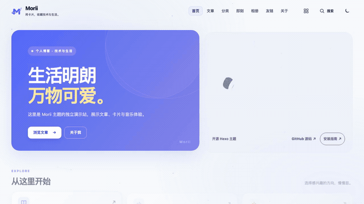

# Morii Theme

[](https://www.npmjs.com/package/hexo-theme-morii)
[](LICENSE)

[English](README.md) · **简体中文**

Morii 是一款面向技术写作与个人博客的卡片式 Hexo 主题，支持简体中文、繁体中文和英文界面。

[教程网站](https://morii-docs.pages.dev/) · [在线演示](https://xichenx.github.io/hexo-theme-morii/) · [版本发布](https://github.com/xichenx/hexo-theme-morii/releases) · [问题反馈](https://github.com/xichenx/hexo-theme-morii/issues)

[](https://github.com/xichenx/hexo-theme-morii/blob/main/docs/media/morii-demo.mp4)

[观看 v1.1.0 的 44 秒演示](https://github.com/xichenx/hexo-theme-morii/blob/main/docs/media/morii-demo.mp4)

## 功能

- 响应式卡片布局、深浅主题和可配置的首页模块。
- 支持高亮摘要的站内全文搜索，以及分类、标签和系列导航。
- 阅读进度、专注模式、稍后阅读和代码块放大查看。
- 相册、即刻、友链、带同步歌词的音乐馆和电影院。

## 安装

需要 Hexo 8 及以上版本和 Node.js 20.19 及以上版本。在博客根目录运行以下命令。

```bash
npm install hexo-theme-morii hexo-renderer-pug
```

在博客的 `_config.yml` 里设置 `theme: morii` 和 `language: zh-CN`，再运行 `npx hexo server` 预览。

## 使用文档

详细步骤和配置示例请看教程站。[五步入门](https://morii-docs.pages.dev/guide/) · [配置手册](https://morii-docs.pages.dev/config/) · [完整示例](https://morii-docs.pages.dev/examples/) · [部署上线](https://morii-docs.pages.dev/guide/publishing) · [升级主题](https://morii-docs.pages.dev/guide/updating)

[更新日志](CHANGELOG.md) · [MIT 许可](LICENSE) · 主题作者 **Morainet**
